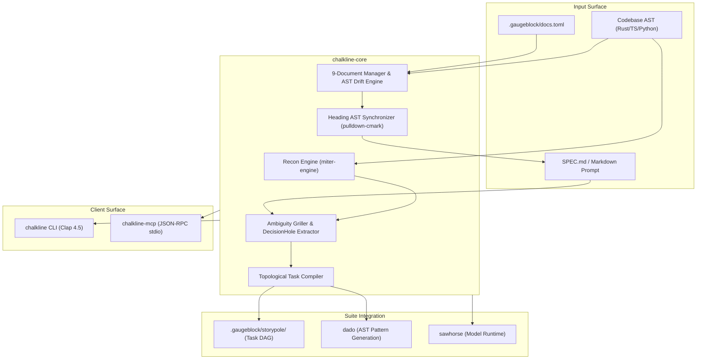

# `chalkline` — System Architecture

> **High-Reliability Specification Planner, Ambiguity Griller & 9-Document Architecture Manager**

Part of the **[`gaugeblock`](https://gaugeblock.dev)** neurosymbolic suite.

---

## 1. High-Level Subsystem Topology

---

## 2. Crate & Package Topology

### `chalkline`
- **Path:** Root facade (`crates/*`)
- **Version:** `0.1.0-beta.3`
- **Description:** Root re-export and ergonomic library facade for `chalkline-core`.

### `chalkline-core`
- **Path:** `crates/chalkline-core`
- **Version:** `0.1.0-beta.3`
- **Description:** Pure domain types, Markdown AST spec parser, AST reconnaissance engine, ambiguity griller, 9-document drift verifier, and native Markdown section synchronizer.

### `chalkline-cli`
- **Path:** `crates/chalkline-cli`
- **Version:** `0.1.0-beta.3`
- **Description:** Clap 4.5 binary entrypoint (`chalkline`) exposing `grill`, `compile-dag`, `sync`, `recon`, and `docs` (`check`, `sync`, `scaffold`, `migrate`).

### `chalkline-mcp`
- **Path:** `crates/chalkline-mcp`
- **Version:** `0.1.0-beta.3`
- **Description:** Model Context Protocol (MCP) stdio JSON-RPC 2.0 server exposing `chalkline_recon`, `chalkline_grill`, `chalkline_compile_dag`, and `chalkline_sync` to AI agents.

---

## 3. Subsystem Pipelines & Dataflows

### A. Codebase Reconnaissance Pipeline (`recon`)
1. Ingests target repository path.
2. Invokes `miter_engine::inspect_workspace` to build a structural `WorkspaceInventory` (crates, public types, CLI subcommands, toolchains, git state).
3. Evaluates heuristic detectors for:
   - Logging/Tracing (`tracing`, `log`, `env_logger`)
   - Async Runtime (`tokio`, `async-std`, `smol`)
   - Error Handling Strategy (`thiserror`, `anyhow`, `snafu`)
   - Database / Storage (`redb`, `rusqlite`, `sqlx`)
4. Emits a normalized `ReconReport` to prevent agents from guessing existing conventions.

### B. Interactive Ambiguity Griller Pipeline (`grill`)
1. Parses markdown specification text into an AST using `pulldown-cmark`.
2. Extracts pending questions and forks into formal `DecisionHole` records.
3. If `--non-interactive` or MCP mode: extracts options and yields decision requirements.
4. If interactive CLI mode: launches an `inquire` terminal prompt for human selection.
5. Injects resolved decisions into a `## Resolved Decisions` section in the target specification.

### C. Topological Task DAG Compiler Pipeline (`compile-dag`)
1. Scans `## Tasks` heading in `SPEC.md` for task items (`- [ ] **KEY:** Description`).
2. Discovers intra-spec dependency expressions (`blocked by`, `depends on`).
3. Validates that the graph is a Directed Acyclic Graph (DAG) with zero cycles.
4. Transacts task creation and dependency edge creation into `storypole-core` append-only ledger (`.gaugeblock/storypole/ledger.jsonl`).

### D. 9-Document Architecture & AST Drift Engine (`docs`)
1. Reads `.gaugeblock/docs.toml` policies or applies canonical defaults.
2. Discovers workspace targets (`discover_workspace_repos`).
3. Performs semantic AST audits across all 9 documents:
   - `ARCHITECTURE.md`: Crate topology verified against `inv.crates`.
   - `SPEC.md`: Public boundary & wire types verified against `inv.public_types`.
   - `README.md`: Subcommands and flags verified against `inv.cli_commands`.
   - `AGENTS.md`: Mandatory non-negotiable laws verified.
   - `CHANGELOG.md`: Active `[Unreleased]` section verified.
   - All documents: Relative markdown link validity verified against disk.
4. Emits structured `DocAuditReport` or suite-wide `WorkspaceDocsAuditReport`.

### E. Native Markdown AST Synchronizer (`docs sync`)
1. Targets standard Markdown heading nodes (`## Crate & Package Topology`, `## CLI Reference`, `## Formal Type Contracts`) via `pulldown-cmark`.
2. Computes the exact byte range from heading end to next equal/higher heading.
3. Surgical-replaces the range with freshly generated AST tables, keeping narrative 100% pure and untouched without HTML comment tags.

---

## 4. Cross-Repository Wire Contracts

* **Consumes from `miter-engine`:** `WorkspaceInventory`, `CrateInventory`, `PublicTypeInventory`, `CliCommandInventory`.
* **Writes to `storypole-core`:** `StorypoleStore`, task nodes, `EdgeKind::BlockedBy`, `EdgeKind::ParentEpic`.
* **Invokes `sawhorse-core`:** `SawhorseConfig`, inference providers for ambiguity analysis.
* **Exports to `dado`:** Normalized `SharedTypeContract` schemas for typed hole code generation.
