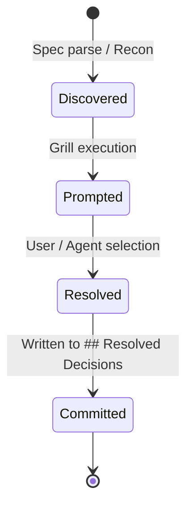
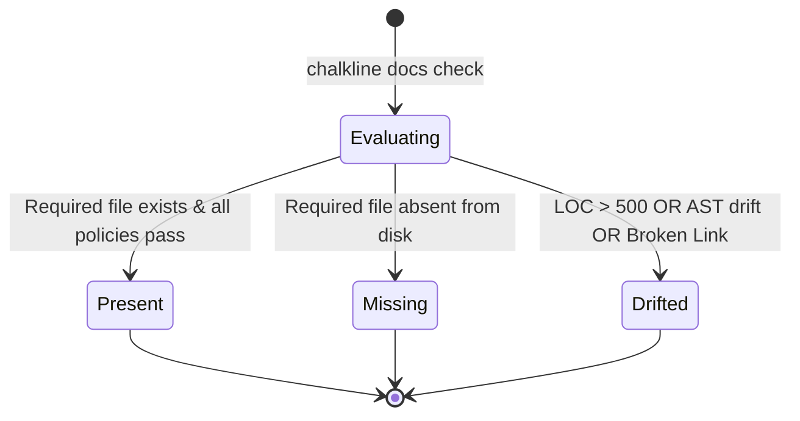

# `chalkline` — Behavioral Specifications & Invariants

> **Formal Invariants, State Machines, CLI Grammar & Wire Schemas**

Part of the **[`gaugeblock`](https://gaugeblock.dev)** neurosymbolic suite.

---

## 1. Behavioral Invariants (DO NOT BREAK)

1. **AST Determinism:** Given the same filesystem state and command inputs, `chalkline recon`, `chalkline docs check`, and `chalkline compile-dag` MUST produce bit-for-bit identical results on every machine.
2. **Pure Markdown Invariance:** `chalkline docs sync` and `chalkline docs check` MUST NOT introduce or require non-standard HTML comment markers. All sections are targeted strictly via `pulldown-cmark` Markdown Heading AST ranges.
3. **Acyclic Task Graphs:** `chalkline compile-dag` MUST perform a topological cycle detection check before committing tasks to `storypole`. Any cycle (e.g. `A -> B -> A`) is an immediate typed `CompileError::CyclicDependency`.
4. **Zero-Panic Library Boundary:** Production library paths in `chalkline-core` MUST NOT call `.unwrap()` or `.expect()`. Every failure must map to a strongly typed `ChalklineError` variant.
5. **Idempotent Synchronization:** Running `chalkline docs sync --apply` consecutively must yield zero file diffs on the second run.

---

## 2. State Machines

### A. DecisionHole Lifecycle State Machine



* `Discovered`: Ambiguity identified in prompt or specification prose.
* `Prompted`: Presented via terminal `inquire` prompt or yielded as an MCP decision hole.
* `Resolved`: Option chosen with recorded rationale.
* `Committed`: Injected into `SPEC.md` under `## Resolved Decisions`.

### B. Document Compliance State Machine



---

## 3. Formal Type Contracts

The following boundary and wire contracts are exported by `chalkline-core`:

| Type | Kind | Module | Summary |
|---|---|---|---|
| `ChalklineError` | `enum` | `chalkline_core::error` | Strongly typed domain error taxonomy covering validation, AST, and I/O. |
| `DocsConfig` | `struct` | `chalkline_core::docs::config` | Master documentation policies and file mappings from `.gaugeblock/docs.toml`. |
| `DocType` | `enum` | `chalkline_core::docs::config` | Canonical 9-document architecture taxonomy. |
| `DocAuditReport` | `struct` | `chalkline_core::docs::drift` | Aggregated repository audit report with missing/drifted counts. |
| `DocAuditItem` | `struct` | `chalkline_core::docs::drift` | Compliance status and detected violations for a single document. |
| `DocStatus` | `enum` | `chalkline_core::docs::drift` | Status enum: `Present`, `Missing`, `Drifted`. |
| `WorkspaceDocsAuditReport` | `struct` | `chalkline_core::docs::workspace` | Multi-repository workspace aggregated audit matrix. |
| `DiscoveredRepo` | `struct` | `chalkline_core::docs::workspace` | Discovered workspace member repository path and metadata. |
| `DecisionHole` | `struct` | `chalkline_core::grill` | Structured ambiguity fork with options and impacted symbols. |
| `DecisionOption` | `struct` | `chalkline_core::model` | Proposed choice for a decision fork with pros, cons, and impacts. |
| `ReconReport` | `struct` | `chalkline_core::recon` | Discovered codebase conventions, testing frameworks, and runtimes. |
| `CompilationReceipt` | `struct` | `chalkline_core::dag_compiler` | Receipt certifying successful compilation of spec tasks into Storypole. |
| `SpecDoc` | `struct` | `chalkline_core::model` | Parsed markdown specification document AST and tasks. |
| `SpecTask` | `struct` | `chalkline_core::model` | Individual specification task item with dependencies. |
| `SharedTypeContract` | `struct` | `chalkline_core::model` | Polyglot cross-language wire contract model. |
| `ContractField` | `struct` | `chalkline_core::model` | Typed field in a shared wire contract schema. |
| `ContractsGenerator` | `struct` | `chalkline_core::contracts_gen` | Generator compiling shared schemas into JSON/code definitions. |
| `DocEntryConfig` | `struct` | `chalkline_core::docs::config` | Individual canonical document path and required status. |
| `DocsPoliciesConfig` | `struct` | `chalkline_core::docs::config` | Verification policies governing AST drift checks. |
| `DocMigrationPlan` | `struct` | `chalkline_core::docs::migration` | Section classification plan for brownfield document migration. |

---

## 4. CLI Grammar & Command Reference

```text
chalkline [OPTIONS] <COMMAND>

Commands:
  recon        Run codebase reconnaissance with miter-engine
  grill        Conduct interactive /grill-me session on a prompt or spec
  compile-dag  Compile tasks from a specification file into a storypole task DAG
  sync         Sync task completion checkboxes between storypole and specification
  docs         Manage, audit, and synchronize the canonical 9-document architecture
  mcp          Launch the stdio JSON-RPC 2.0 Model Context Protocol server

Docs Subcommands:
  check        Audit repository documentation against .gaugeblock/docs.toml and code AST
               Flags: -w, --workspace  Audit all member repos across the workspace
  sync         Synchronize AST-grounded sections into canonical documents
               Flags: --apply          Write updated sections directly to disk
  scaffold     Scaffold missing repository documentation using AST-grounded templates
               Flags: --doc <TYPE>     Only scaffold specific document type
                      --force          Force overwrite of existing files
  migrate      Disentangle a brownfield document into the 9 canonical documents
               Flags: --apply          Apply disentangled sections directly to disk
```

### Exit Codes
* `0`: Success (all checks passed, command completed without errors).
* `1`: General error or validation failure (documentation audit detected missing/drifted documents).
* `2`: CLI argument parsing error (invalid flags or missing arguments).
